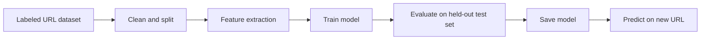

# 🎣 Phishing URL Detector

A machine learning project that classifies a URL as **phishing** or **legitimate** using features extracted from the URL itself.

---

## 📌 Why this project

Phishing is one of the most common ways attackers gain access. Many malicious URLs look different from normal ones: they're longer, use IP addresses, stack subdomains, or hide extra characters. This project explores how well a model can learn those patterns, and what it can't learn.

## ✨ Features

Load and clean a public labeled URL dataset
Extract URL features (see below)
Baseline model: Logistic Regression
Improved model: Random Forest, compared against the baseline
Evaluation: accuracy, precision, recall, F1 and a confusion matrix
Save the trained model and load it for predictions
Command-line or small web page to check a new URL
Unit tests for the feature extraction

## 🏗️ Pipeline



### Planned features

| Feature | Why it may help |
|---|---|
| URL length | Phishing URLs are often longer |
| Number of dots and subdomains | Stacked subdomains can imitate trusted sites |
| Contains `@` | Can hide the real destination |
| Host is an IP address | Rare for legitimate sites |
| Number of hyphens and digits | Common in lookalike domains |
| Uses HTTPS | Weak signal on its own, since many phishing sites use HTTPS too |
| Suspicious keywords (`login`, `verify`, `secure`) | Common in lure URLs |
| Character entropy | Random-looking strings can signal generated domains |


## 🛠️ Tech stack

Python 3.9+, pandas, scikit-learn, joblib (for saving the model), pytest

## 📁 Project structure (planned)

```
phishing-url-detector/
├── data/                # dataset notes (do not commit large raw files)
├── features.py          # URL feature extraction
├── train.py             # training and evaluation
├── predict.py           # check a single URL
├── tests/
│   └── test_features.py
├── notebooks/           # exploration
├── requirements.txt
└── README.md
```

## 🚀 Getting started

```bash
git clone https://github.com/HariniCyber/phishing-url-detector.git
cd phishing-url-detector
pip install -r requirements.txt
python train.py
python predict.py "http://example.com/login"
```

| Model | Accuracy | Precision | Recall | F1 |
|---|---|---|---|---|
| Logistic Regression | to be added | to be added | to be added | to be added |
| Random Forest | to be added | to be added | to be added | to be added |


## ⚠️ Limitations

- Uses only features from the URL text, not page content, domain age or reputation.
- Performance on this dataset may not carry over to new phishing campaigns.
- Attackers can adapt URLs to avoid known patterns.
- Never rely on this alone to decide whether a link is safe.


## 🗺️ Roadmap

Add domain-based features (age, registrar) using allowed sources
Try gradient boosting and compare
Explain predictions with feature importance
Deploy a small demo app

## 📚 What I learned

I learned feature engineering, evaluation metrics, avoiding data leakage.

## 📄 License

MIT
